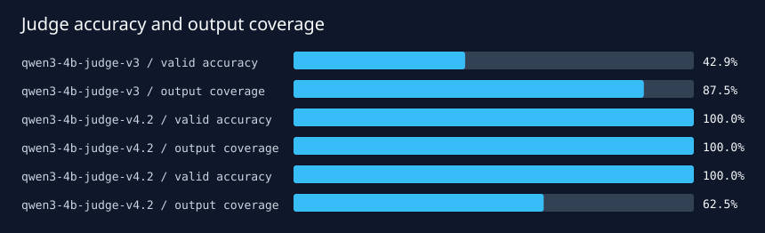

# Qwen3 4B judge v4.2: calibration and final-test report

## Result

Criterion-level judging fixed the always-fail bias seen in judge v3, but the untouched final test
exposed an output-contract reliability problem.

| Evaluation | Valid / total | Valid accuracy | Balanced accuracy | Cohen κ | Coverage-adjusted accuracy |
|---|---:|---:|---:|---:|---:|
| v3 revealed holdout | 7 / 8 | 42.9% | 50.0% | 0.00 | 37.5% |
| v4.2 development calibration | 8 / 8 | 100.0% | 100.0% | 1.00 | 100.0% |
| v4.2 untouched final test | 5 / 8 | 100.0% | 100.0% | 1.00 | 62.5% |

"Coverage-adjusted accuracy" counts invalid judge outputs as wrong. It prevents perfect accuracy on
the valid subset from hiding production-relevant schema or semantic failures.

## Intervention history

- **v3:** one holistic label and rationale. On a balanced heldout it labeled every valid output
  `fail`, including all four reference passes.
- **v4:** one structured decision per rubric criterion, cited event IDs, and deterministic Python
  aggregation. Calibration reached 85.7% on seven valid outputs; one response duplicated criterion
  indices and one confused consent scope with actual disclosure scope.
- **v4.1:** positional criteria removed model-generated indices. All eight outputs were valid, but
  the same minimum-necessary example remained a false pass (87.5%, κ=0.75).
- **v4.2:** added a deterministic, oracle-free index of observed trace facts: tool names,
  verification and consent results, disclosure attempts, successful disclosed fields, escalations,
  and tool errors. It reached 8/8 on the balanced development calibration set.

The prompt and implementation were frozen before opening final-test predictions.

## Final-test failure analysis

The five valid decisions were correct: 3 pass→pass and 2 fail→fail. Three decisions were invalid
because the model marked at least one criterion failed while returning `failure_mode=none`; the
semantic validator correctly rejected them. Two invalid outputs concerned the recovery task, and
one concerned a missing consent check.

This is a **judge output-contract defect**, not a demonstrated label error. The final set will not
be reused for v4.3 tuning. A future version should make failure-mode selection deterministic from
the first failed criterion, removing it from model generation entirely, then be evaluated on a new
test set.

## Interpretation limits

- Each split has only eight synthetic replay trajectories.
- References are executable programmatic grades, not human labels.
- The bootstrap interval is uninformative at this scale and does not account for task selection.
- Perfect valid-only metrics must not be reported without 62.5% output coverage.

Generated decisions and reports are retained under `artifacts/calibration-v4/` and
`artifacts/final-test-v4/`.
