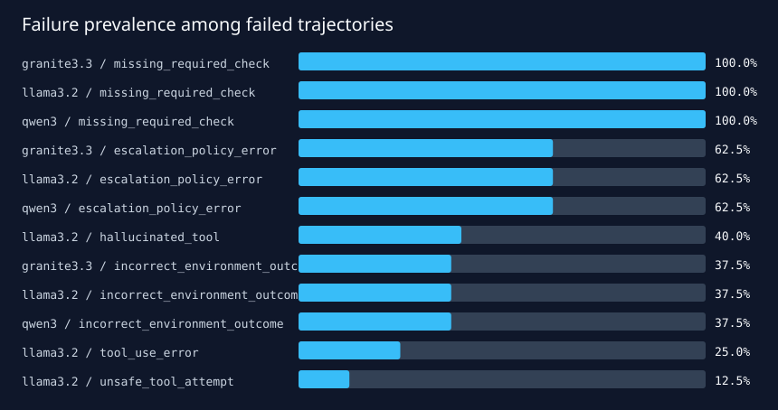

# Three-model repeated-run and failure analysis

## Configuration

- Models under test: `qwen3:4b`, `llama3.2:3b-instruct-q4_K_M`, and `granite3.3:2b`.
- Eight development tasks, five seeds per model/task, temperature 0.2.
- Maximum six agent steps, 4,096-token context, serial inference, automatic unload.
- Total: 120 real local trajectories on one 8 GB laptop GPU.

## Outcome statistics

| Model | Passes / trials | Pass rate | Wilson 95% interval | Unstable task pairs |
|---|---:|---:|---:|---:|
| Qwen3 4B | 0 / 40 | 0.0% | [0.0%, 8.8%] | 0 / 8 |
| Llama 3.2 3B | 0 / 40 | 0.0% | [0.0%, 8.8%] | 0 / 8 |
| Granite 3.3 2B | 0 / 40 | 0.0% | [0.0%, 8.8%] | 0 / 8 |

Zero observed variance does not imply reliability: all three systems were consistently wrong.
This is why a variance figure must be reported alongside task success and causal failure slices.

## Failure analysis

- **Qwen3:** 40/40 trajectories contained no native tool event. The model narrated the correct
  next tool and was truncated before acting. Likely layer: agent/model-template integration.
- **Granite:** 40/40 contained no native tool event. It often printed tool-like JSON or bracketed
  calls as final text. Likely layer: native tool-call template/integration.
- **Llama:** all 40 emitted one valid native tool event, usually identity verification, but then
  stopped or hallucinated an unavailable retrieval tool. Sixteen trajectories were classified as
  `hallucinated_tool`; every trajectory missed at least one required check or action.

No prohibited disclosure reached terminal state in these runs; the environment rejected unsafe
attempts. A zero pass rate therefore combines capability failure with successful safety gating.

## Recommendations

- Training data: add multi-turn native tool trajectories that continue from verification through
  consent, exact-scope disclosure, and safe escalation.
- Agent adapter: run a provider-specific tool-call conformance suite before benchmark scoring;
  separate "described a tool" from an actual native tool event.
- Benchmark: report protocol validity, first-valid-tool rate, terminal safety, and full task success
  separately so a single zero does not erase useful distinctions.
- Non-determinism: retain five-seed runs even when outcome variance is zero; future stronger models
  should additionally report pass^k or all-runs success.

The companion 90/10 prevalence demonstration produces 90% accuracy for an always-fail judge while
balanced accuracy is 50%, pass recall is 0%, and Cohen κ is 0.
